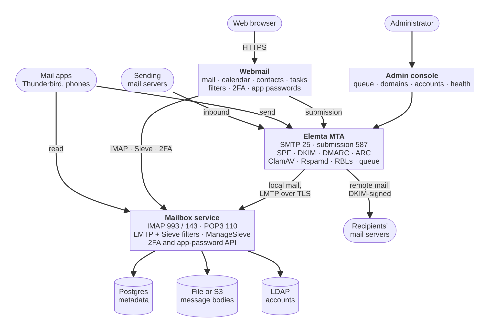

# Elemta

Elemta is a self-hosted email platform written in Go: a mail server (MTA),
its own mailbox server, webmail with calendar, contacts and tasks, and an
admin console, built to work together and deployed as one stack.

## What's in the stack



Every part uses the LDAP directory for accounts, aliases, quotas and groups.
More diagrams, of the Docker Compose stack, the cloud server and Kubernetes,
are in [Architecture](docs/architecture.md).

### Mail server (MTA)

- Inbound MX and authenticated submission (STARTTLS, LDAP, file or SQL users)
- SPF, DKIM verification and signing, DMARC, ARC sealing, DNS blocklists
- ClamAV and Rspamd scanning, per-sender and per-destination rate limits
- Queue backends: `file` (default), `sqlite`, `indexedfs`, and `postgres` for
  multiple nodes; delivery over LMTP (with TLS) or SMTP, sending IP pools
- Defences against SMTP smuggling and command injection; plugin pipeline

### Mailbox service

- IMAP4rev1 on 993 (implicit TLS) and 143 (STARTTLS required), POP3
  on 110 (STLS required)
- IDLE, MOVE, CONDSTORE/QRESYNC, SORT, THREAD, QUOTA and indexed full-text
  search, so phones and desktop clients resynchronise quickly
- Sieve filtering at delivery (fileinto, vacation, regex, redirect) and
  ManageSieve for filter editors
- Postgres metadata with file or S3 message storage; stateless replicas behind
  HAProxy; backups, a restore drill and a consistency check

### Webmail

- Mail with conversations, search, rich-text compose and attachments
- Calendar with invitations, contacts and tasks, synced to phones over CalDAV
  and CardDAV
- Mail filters and out-of-office replies
- Two-step verification (TOTP), app passwords for mail apps, password
  recovery, light and dark themes

### Administration

- Web admin console for the queue, domains, accounts, plugins and health
- `elemta provision` CLI for domains, accounts, aliases and quotas
- Prometheus metrics, health endpoints and structured logs

## Quick start

```bash
git clone https://github.com/EvalAlan/elemta.git
cd elemta
make install        # setup wizard: a dev stack, or a mail server for your domain
```

`make install-dev` skips the questions and starts the development stack. When
it's ready:

| What | Where |
|---|---|
| Webmail | http://localhost:8027 (sign in as `user@example.com`, password `password`) |
| Admin console | http://localhost:8025 (login printed by the install) |
| SMTP / submission | `localhost:2525` / `localhost:2587` |
| IMAP | `localhost:993` (TLS, self-signed development certificate) |

`make install-dev-full` adds ClamAV, Rspamd and Roundcube. Day to day:
`make status`, `make logs-elemta`, `make test`.

Other ways to run it:

- **One internet-facing server** with real certificates, the public mail ports
  and a hardened host: [Cloud dev server](docs/cloud-dev.md).
- **From source:** `make build`, then `./bin/elemta server --config ./config/elemta.toml`.
- **Kubernetes:** `make k8s-install-dev-full`, or Elemta alone with
  `kubectl apply -k deployments/kubernetes/standalone`. See
  [deployments/kubernetes](deployments/kubernetes/README.md).

## Documentation

- [Documentation index](docs/README.md)
- [Architecture](docs/architecture.md): diagrams of the components, mail flow,
  the Docker Compose stack, the cloud server and Kubernetes
- [User guide](docs/user-guide.md): webmail, mail apps, two-step verification
- [Installation](docs/installation.md) and [Configuration](docs/configuration.md)
- [Mailbox service](docs/mailbox-service.md)
- [Mail administration](docs/mail-administration.md)
- [Cloud dev server](docs/cloud-dev.md)
- [Production deployment](docs/production-deployment.md) and
  [production readiness: honest assessment and limitations](docs/production-readiness.md)

## Security and project governance

- [Security policy](SECURITY.md)
- [Contributing guide](CONTRIBUTING.md)
- [Code of conduct](CODE_OF_CONDUCT.md)
- [Support](SUPPORT.md)

## Contributing

PRs are welcome. Before opening one:

1. Run tests and lint locally (`make test` and `make lint`)
2. Update docs when behaviour or configuration changes
3. Keep changes focused and scoped

Full guide: [CONTRIBUTING.md](CONTRIBUTING.md)

## License

MIT. See [LICENSE](LICENSE).
