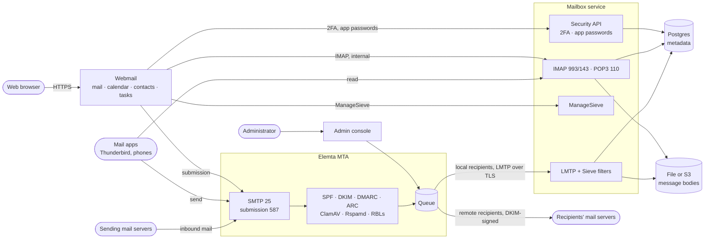
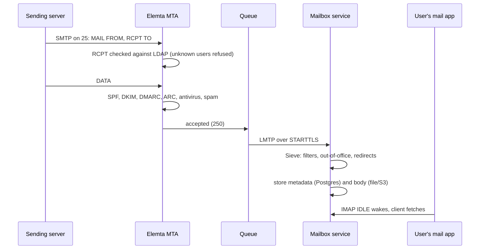
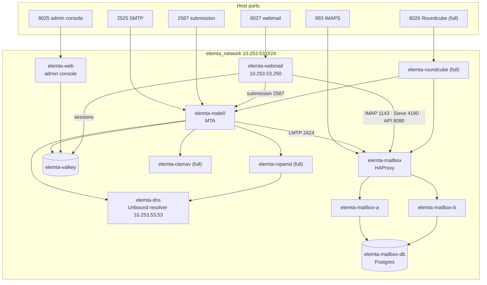
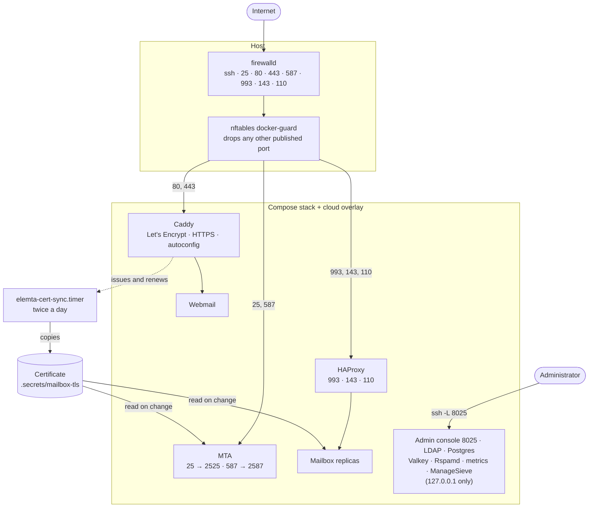
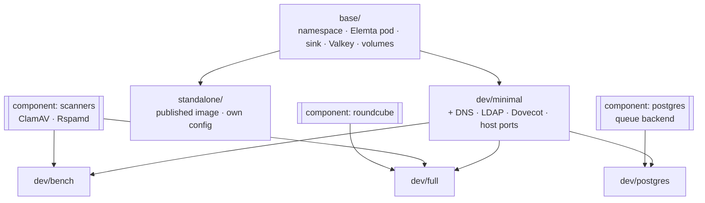
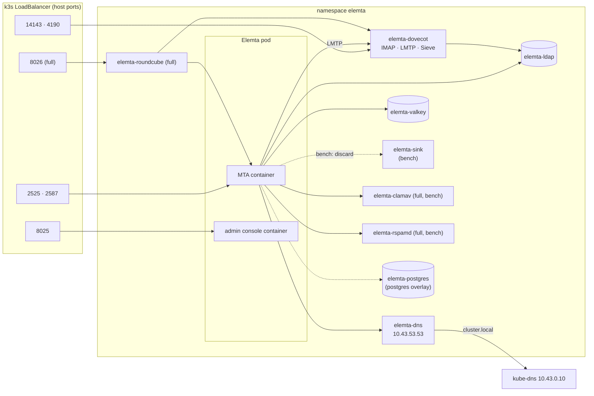

# Architecture

How Elemta's parts fit together, and how each way of running it lays them out:
the Docker Compose development stack, the cloud server, and Kubernetes. The
diagrams are Mermaid, which GitHub renders.

## Components and mail flow

Every deployment has the same parts. The **MTA** (`elemta`) takes mail in and
sends it out. The **mailbox service** stores it and serves it over IMAP and
POP3. The **webmail** is how people read it in a browser. The **admin
console** runs the server. An **LDAP directory** holds the accounts.

Every part looks accounts up in the **LDAP directory** (addresses, aliases,
quotas, groups and passwords), so it is left out of the diagram. SMTP AUTH
also asks the mailbox service's security API whether a user requires app
passwords.

### A message from the internet to a mailbox

## Docker Compose: the development stack

`make install-dev` runs `deployments/compose/docker-compose.yml`. Every
service is on one bridge network, `elemta_network` (10.253.53.0/24), and
reaches the others by container name. The mailbox service runs as two
replicas behind HAProxy, so restarting one doesn't interrupt mail.

`elemta-ldap` (OpenLDAP) is on the same network and used by the MTA, admin
console, webmail and mailbox replicas; its connections are left out to keep the
diagram readable.

Volumes keep state across restarts: `elemta_queue` (the queue),
`elemta_config` (the configuration the admin console edits), `mailbox_metadata`
(Postgres), `mailbox_bodies` (message files), `ldap_data` and `valkey_data`.

## The cloud server

[`scripts/cloud-deploy.sh`](cloud-dev.md) runs the same stack on one
internet-facing host, with `docker-compose.cloud.yml` layered on top. Only the
mail and web ports are public. Everything else is bound to 127.0.0.1 and
reached over SSH. Two layers filter traffic: firewalld for the host, and an
nftables guard for Docker's published ports, which bypass firewalld.

## Kubernetes

Kubernetes manifests are kustomize overlays in `deployments/kubernetes`,
written for a single-node k3s cluster. `make k8s-install-dev*` applies the dev
overlays. The standalone overlay runs the MTA alone from the published image.

The dev stack's pods and how they connect. The Elemta pod runs the MTA and
the admin console as two containers sharing the queue and runtime
configuration. Services keep their Compose names, so the same `elemta.toml`
works in both.

> **Kubernetes still runs Dovecot.** The Kubernetes dev overlay hasn't been
> moved to the mailbox service and webmail yet. Until it is, use the Compose
> stack or the cloud server for the full mail platform.
