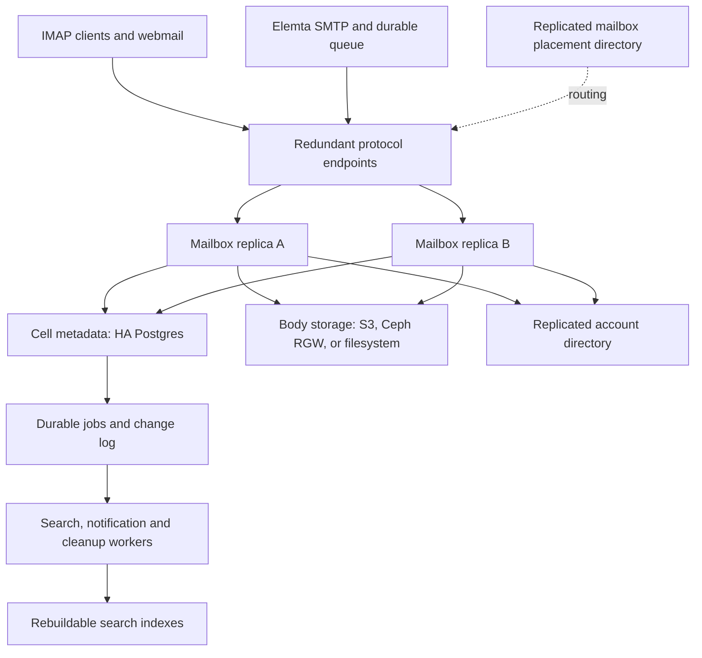

# Proposed mailbox engine and local development deployment

Status: architecture target, 2026-10-18. A first [mailbox service](mailbox-service.md)
now implements the core engine and is the default in the development Compose
stack. See the [development cutover](mailbox-dev-cutover.md). The remaining
sections describe the broader target and optional isolated labs. The
existing optional Postgres ObjectStore holds calendar/contact/task/settings
objects; it is not a mail metadata engine or an HA deployment.

Build an Elemta mailbox engine with interchangeable message-body storage,
transactional metadata, and interchangeable protocol frontends. The target
is millions of mailboxes across independently operated cells. Capacity per
cell must come from measured workload and recovery time, not an assumed
mailbox count.

## Architecture



Keep the mailbox engine independent of IMAP: a shared internal API powers
IMAP, LMTP delivery and eventually direct webmail access. Initially retain
the webmail's IMAP adapter to exercise the same public protocol clients use.
DAV continues through ObjectStore. Co-locate its SQL data with the owning
cell using a separate schema; do not put every cell's calendars into one
global database.

### State ownership

| State | Authoritative location | Failure/recovery behavior |
|---|---|---|
| Exact RFC 5322 message bytes | Immutable objects in configured body store | Never reconstruct mail from search indexes |
| Mailboxes, folders, UIDVALIDITY, next UID, flags, keywords, MODSEQ | Cell Postgres | Transactional mutations, replicated durability |
| Message-to-folder membership, body locator, size/checksum, quota usage | Cell Postgres | Listing and flags never require bucket enumeration |
| Delivery retry keys, job outbox and ordered mailbox changes | Cell Postgres | Retry/replay survives replica failure |
| Search index | Derived per-cell storage/service | Rebuildable; index lag does not stop delivery |
| Account identity and password verification | Replicated directory | Avoid a single LDAP endpoint dependency |
| Account-to-cell assignment and migration epoch | Replicated placement control plane | Cached reads permit existing cells to operate during control-plane outage |
| Active sockets, MIME/body cache, notification hints | Replica memory or expendable cache | Clients reconnect; change log repairs missed hints |

A stable internal account ID owns data. Email addresses and aliases are
mutable directory attributes, not storage keys. This differs from the
current ObjectStore's address keys; account-ID migration is required before
integrating it into this engine.

### Storage drivers

| Driver | Implementation | Intended deployment |
|---|---|---|
| `file` | Immutable files with exclusive publication, checksums, file and directory fsync | Development; HA only with a separately qualified shared filesystem |
| `s3` | Streaming PUT/GET, range reads, HEAD/checksum verification, DELETE, multipart handling | AWS S3 and separately tested compatible endpoints |
| Ceph RGW | The S3 driver with a Ceph endpoint | Distributed object storage; test deployed Ceph release capabilities |
| CephFS | The file driver with an externally managed mount | Optional; filesystem semantics and availability must be qualified |

Do not start with a native RADOS driver: Ceph RGW already exposes an
[S3-compatible interface](https://docs.ceph.com/en/latest/radosgw/).
S3 compatibility is a tested capability matrix, not a blanket guarantee.
Keep backend identity, bucket/root and immutable key on each body reference
so an account can move between storage pools without changing message IDs.
Do not expose customer-controlled filesystem paths or object keys.

The body interface needs streaming upload, verified publication, range
reads and idempotent deletion. Mailbox operations belong in the metadata
engine, not in the body driver. Retain the original MIME bytes; add tenant
scoping, encryption/key rotation hooks, bounded temporary space and upload
limits. Avoid cross-tenant deduplication initially.

## Correctness before scale

### Delivery and append

1. Authenticate the caller, resolve the account's owning cell and authorize
   delivery. Internal delivery carries a stable retry token tied to queue
   entry and recipient. Ordinary IMAP APPEND remains a new operation unless
   a client supplies a supported operation token.
2. Reserve an upload intent and unique body key. Stream and verify the body
   into the chosen store. Keep body I/O outside mailbox mutation locks.
3. In a short metadata transaction, lock the affected mailbox/quota rows,
   verify that the cell/account still permits writes, allocate the UID and
   MODSEQ, add membership and quota usage, record the delivery retry result,
   and append durable notification/indexing jobs.
4. Commit at the configured replicated durability level, then acknowledge
   LMTP delivery or IMAP APPEND. A prior successful retry token returns its
   recorded result. A disconnect around commit is an uncertain outcome,
   resolved by that token on retry.

SQL and object storage have no shared transaction. Failed metadata commits
can leave staged objects; they must not leave visible mail referencing an
unpublished body. Upload intents need expiry/fencing. Cleanup must coordinate
with attachment transactions so an expired uploader cannot publish a
reference after its object has been selected for deletion. Mark objects
retiring transactionally, forbid new references to retiring keys, then delete
after the configured reader/retention grace period. Never reuse retired keys.

Do not deduplicate by Message-ID: distinct legitimate messages can share it.
The current SMTP-to-LMTP path would need a negotiated internal retry-token
extension or authenticated delivery API. Standard LMTP alone does not supply
that application-level idempotency contract.

### Concurrent clients and background work

Serialize conflicting mutations with database transactions/row locks, not
process-local mutexes. Replicas may serve the same mailbox concurrently.
UID allocation, expunge, flags, quotas and ordered changes must agree across
replicas. Preserve UIDs and UIDVALIDITY on restart and failover. The protocol
implementation must satisfy [IMAP state and synchronization rules](https://www.rfc-editor.org/info/rfc9051/).

Persist change sequence numbers with mailbox mutations. Pub/sub and database
notifications only wake consumers; consumers replay changes by sequence.
Periodic reconciliation covers lost wakeups. Index and cleanup workers claim
bounded durable jobs with expiring leases and retry safely after crashes.

Begin with search workers and a Postgres full-text candidate index for small
development workloads, checking exact IMAP semantics against original data
where needed. Choose the production search service after measuring message
size, language/tokenization requirements, query mix, index lag and rebuild
time. A generic text index alone is not a complete IMAP SEARCH implementation.

## Availability and failure domains

For a production cell, propose at least two mailbox replicas and two edge
instances across failure zones; three Postgres members (primary and two
standbys); and a three-voter coordination quorum. Use Patroni or a managed
equivalent, primary-aware connection routing, and verified fencing of an old
primary. A TCP-open health check cannot identify a writable primary.

Require synchronous durable replication to at least one eligible standby
for acknowledged mailbox writes. Failover selection must preserve those
acknowledged commits. Do not silently weaken the policy to asynchronous
replication when a standby disappears. PostgreSQL explains the durability
and latency choices in its [replication documentation](https://www.postgresql.org/docs/17/warm-standby.html);
Patroni documents [synchronous/quorum modes and their limits](https://patroni.readthedocs.io/en/latest/replication_modes.html).

Proposed acceptance targets, not current guarantees: RPO 0 for acknowledged
mailbox mutations under a single covered host/zone failure, and service
recovery within 60 seconds. The body store must satisfy the same covered
failure model. Clients may lose sockets and reconnect. Test whether these
targets are attainable with the selected storage and failover policy.

Production also needs redundant body-store access, directory services,
routing, DNS and TLS endpoints. A single-host file volume, S3 fixture,
Valkey process or edge proxy is not HA. Valkey must not own authoritative
mail state. Decide separately whether a session-cache outage can require
sign-in again or needs its own HA deployment.

The existing SMTP queue is another independent durability boundary: SMTP
acceptance occurs before LMTP delivery. A single local queue disk can lose
accepted mail even if the mailbox engine is HA. End-to-end RPO 0 therefore
also requires a replicated durable queue/journal before the SMTP `250`
acceptance response. The proposed engine does not retrofit that guarantee.

Cells should keep serving already assigned accounts during a placement
control-plane outage. Freeze account creation/moves when placement cannot
be changed safely. Moving an account requires quiescing and fencing source
writes, copying/reconciling data, updating the placement epoch and enabling
the destination. Never allow stale routing to create two writable owners.

Backups are independent of replication: archive database WAL and base
backups, retain body versions/objects long enough to restore matching
metadata snapshots, protect credentials/keys, and rehearse restores into an
isolated cell. Coordinate garbage collection with the backup retention
window so a database restore does not reference already deleted bodies.

## Original isolated lab on this system

The section below records the proposal and its separate test project. The
normal development stack now uses the same two-engine pattern with its own
metadata/body volumes; Dovecot is stopped and retained for explicit rollback.
See [the current deployment and migration procedure](mailbox-dev-cutover.md).

Observed during this proposal: 14 logical CPUs, about 31 GiB RAM with 18 GiB
available, and about 4.5 TiB free on the repository filesystem. Docker's
root is `/var/lib/docker`, on a different filesystem with about 503 GiB
free. Named volumes consume that smaller disk unless explicitly relocated;
budget body/index/backup space there before large-message tests. These
observations are not a capacity benchmark. The
then-current eight Elemta services included Dovecot.

Add a separate four-container project alongside them:

```text
Original SMTP/webmail/Dovecot/LDAP/Valkey stack during isolated testing
                           |
            existing Docker network (LDAP access only)
                           |
localhost:11443 IMAP --> mailbox edge --> mailbox-a ---+
localhost:12424 LMTP -->              --> mailbox-b ---+--> Postgres metadata
                                                     +--> shared body volume
```

| Added container | Memory limit | CPU limit | Role |
|---|---:|---:|---|
| `metadata` | 1 GiB | 1 | One disposable-development Postgres instance |
| `mailbox-a` | 512 MiB | 1 | IMAP/LMTP, metadata API, bounded workers |
| `mailbox-b` | 512 MiB | 1 | Same code, independent process |
| `edge` | 128 MiB | 0.5 | TCP routing with readiness checks |
| Total | 2.125 GiB | 3.5 | Limits, not measured consumption or promised throughput |

Use named volumes for metadata and bodies; each engine mounts the same body
volume. Start with two engines to catch process-local assumptions early.
The default file backend avoids running a storage cluster on a development
workstation. Add an optional single-node S3 fixture when implementing the
S3 contract, or point test accounts at a dedicated AWS/Ceph test bucket.
The S3 fixture is test infrastructure and provides no additional HA.

The implemented daily deployment is
[`docker-compose.mailbox.yml`](../deployments/compose/docker-compose.mailbox.yml),
with [`config/mailbox.toml`](../config/mailbox.toml). Start it with
`make mailbox-dev-up`; operation, verification and known limits are documented
in [mailbox-service.md](mailbox-service.md). An optional webmail instance on
18037 exercises the new mailbox without changing the main stack.

Both exposed ports bind to localhost and differ from current ports 14143
and 2424. The proposed IMAP port 11443 carries plaintext development IMAP,
despite its number; use STARTTLS/implicit TLS once implemented. There is no
automatic change to SMTP's LMTP destination or webmail's IMAP configuration.
Use dedicated test accounts and a temporary webmail instance before any
cutover. No live Maildir volume is mounted into the proposed engine.

### What this minimum tests

Kill one engine and verify delivery/IMAP reconnect through the other; send
conflicting changes to both; restart containers and preserve UIDs; interrupt
uploads and verify cleanup; retry an ambiguous delivery; rebuild search;
and switch a test account between file and S3 storage with checksum checks.

The minimum intentionally has one database, one edge and one physical disk.
It tests engine replication and recovery logic, not host-failure tolerance.
Keeping two containers does not make their shared dependencies redundant.

## Local failover lab, then production

Use a separate future HA lab when testing automatic failover. Retain two
engine replicas; replace the single database with three Postgres/Patroni
members and three coordination voters. Use two edge instances, each also
providing primary-aware database routing to its paired engine. Expose two
distinct local entry ports for tests; a client harness retries the alternate
entry. This does not pretend a shared localhost port is a redundant ingress.

| Lab component | Count | Starting memory limit each |
|---|---:|---:|
| Postgres/Patroni | 3 | 1.5 GiB |
| Coordination voters | 3 | 128 MiB |
| Mailbox engines/workers | 2 | 1 GiB |
| Edge/database routing | 2 | 128 MiB |
| Optional S3 fixture | 1 | 1 GiB |
| Total | 10, or 11 with S3 | 7.125 GiB, or 8.125 GiB with S3 |

The [implemented HA lab](../deployments/compose/docker-compose.mailbox-ha.yml)
starts with `make mailbox-ha-dev-up`. Its shared filesystem body volume is a
container-failure fixture, not replicated host storage. The budget leaves
headroom on this machine for the current stack, compiler and browser tests,
but sustained load may need lower concurrency or stopped development tools.
Do not run a full Ceph cluster by default here. Validate the S3 driver against
real Ceph in a separate environment.

The lab must inject primary loss, stale primary rejoin, lost quorum, engine
death, object-store outage, directory outage, duplicate delivery and a
partitioned client. Verify commit survival, retry behavior, fencing, bounded
queues and recovery time. It cannot validate physical host, disk, power or
zone independence because all containers share this host.

Production spreads those roles across at least three real failure domains,
uses redundant ingress and qualified replicated storage, and tests host/zone
loss directly. For many cells, avoid one shared global Ceph cluster or metadata
database becoming a dependency for all mailboxes. Large tenants may need
multiple mailbox shards within their assigned cells.

## Implementation order and replacement gates

1. Define mailbox/storage contracts and durable metadata schema. Implement
   file storage, transactional append/move/flags/expunge, quotas, retry keys,
   outbox, crash recovery and cleanup. Prove two replicas share correct state.
2. Add S3 and Ceph contract tests, range reads, multipart recovery, checksums,
   safe backend moves and backup/restore reconciliation.
3. Implement IMAP and LMTP with the extensions the current webmail relies
   on: IDLE, UIDPLUS, MOVE, SPECIAL-USE, SORT/THREAD, quota and search; evaluate
   CONDSTORE/QRESYNC explicitly. Replace ManageSieve/Sieve execution,
   vacation, duplicate suppression and full-text indexing before retirement.
4. Build the HA lab and satisfy the durability/failure acceptance targets.
   Test real desktop/mobile clients, load, connection storms and restore time.
5. Import selected accounts with mailbox UID/UIDVALIDITY preservation,
   reconcile message counts/checksums/flags, and cut over one authoritative
   owner at a time. Keep an explicit rollback path that accounts for new mail.
6. Establish measured per-cell limits, automate cell/account placement and
   movement, and expand gradually. Millions of mailboxes is the aggregate
   design target; no present deployment has demonstrated that capacity.

The first service does not replace Dovecot or migrate existing mail.
See [remaining replacement gates](mailbox-service.md#remaining-replacement-gates)
for the functionality and qualification still required.
